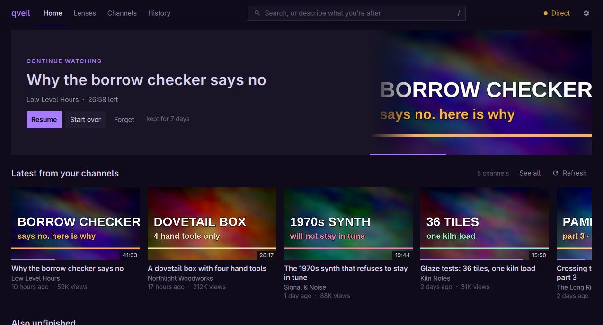

# qveil

A private, account-free YouTube app for Arch Linux and Omarchy. Subscribe,
search and watch in a native window with no Google account, no stored cookies and
no browser, and optionally route every byte through Tor.



> **Prototype.** It works day to day, but expect rough edges. Not affiliated
> with YouTube or Google.

## Install

On Arch / Omarchy, from a checkout of this repository:

```sh
git clone https://github.com/quinprobably-netizen/qveil
cd qveil
bin/install          # builds this checkout and installs the package; qveil appears in the launcher
```

`bin/install` packages what is in your working tree, uncommitted edits
included, so it is also how you install your own changes: it copies the tree
to a scratch directory, builds there and runs the engine's tests
(`pkgbuild/PKGBUILD.local`, which differs from the release recipe only in where
the source comes from). A release is built from its tag instead, which is what
a package repository would do, and downloads the tagged source from GitHub:

```sh
cd pkgbuild
makepkg -si          # builds the tag v<version> (core/Cargo.toml's version) once it exists
```

qveil is only packaged for Arch and Omarchy. The package pulls in Qt 6, mpv
(libmpv), yt-dlp (keep it updated: it follows YouTube's changes) and [deno]
(yt-dlp needs a JavaScript runtime for YouTube), and Rust and git are needed to
build. For the Tor route, install it with `sudo pacman -S tor` and run
`sudo systemctl enable --now tor`.

**Upgrading from veil.** qveil is veil under a new name. pacman asks whether to
replace `veil` (the two conflict): answer `y`. Your subscriptions, history and
settings move to the new locations on first launch. If both names had a file of
the same name, the old one stays where it was (and is made private); `qveil
config` lists what is left over, and `qveil wipe` removes it.

Settings are in `~/.config/qveil/config.toml`; a commented example is installed
as `/usr/share/doc/qveil/config.example.toml`.

## Privacy model

This section is printed by `qveil-core privacy --markdown`, the same text the window shows, and a test fails if it differs from the engine's.

<!-- privacy:begin -->
qveil can't make you invisible to YouTube: it still has to ask YouTube for videos. The goal is to give YouTube as little as possible to link together, and to keep everything else on your machine.

**The routes**

| Route | |
|---|---|
| **Direct** | YouTube sees your IP address. |
| **Tor** | Fresh SOCKS credentials per request, which Tor puts on separate circuits (a video, and a page of thumbnails, each share one); requests can still be linked by their fingerprint and timing. |
| **Proxy** | A proxy you trust, such as a VPN's: YouTube sees its address, not yours. A SOCKS proxy gets fresh credentials per request (a separate circuit if it is Tor); a proxy URL with credentials of its own is not isolated. |

**What a route does**

- **Direct.** YouTube sees your IP address with every request, which links them all.
- **Tor (127.0.0.1:9050).** Requests go through the SOCKS proxy on 127.0.0.1:9050 (Tor), so YouTube sees an exit node's address instead of yours. Requests go out with fresh SOCKS credentials per request (a separate circuit if this is Tor), except that a video's lookup and its bytes share one set, as do the thumbnails of one page. A video that outlives its circuit is looked up again on a fresh one, which links the two circuits: it is the same video, resumed at the same byte.
- **Another SOCKS proxy.** Requests go through your SOCKS proxy, so YouTube sees its address instead of yours; if it is Tor, that is an exit node's. Requests go out with fresh SOCKS credentials per request (a separate circuit if this is Tor), except that a video's lookup and its bytes share one set, as do the thumbnails of one page. A video that outlives its circuit is looked up again on a fresh one, which links the two circuits: it is the same video, resumed at the same byte.
- **A SOCKS proxy with credentials in its URL.** Requests go through your SOCKS proxy, so YouTube sees its address instead of yours. The proxy URL has credentials of its own, which every request sends, so qveil can't isolate requests: they all share one identity (not isolated).
- **An HTTP or HTTPS proxy.** Requests go through your HTTP proxy, so YouTube sees its address instead of yours. qveil can't isolate requests on an HTTP proxy: they all leave from its address (not isolated).

**On every route**

- qveil's requests carry a browser User-Agent on a TLS handshake that no browser makes, which is probably rare, so a careful observer can link them by that fingerprint, even across circuits.
- Refreshing your subscriptions asks for each channel on its own, in random order, skipping channels fetched in the last 15 minutes: that is still a burst of requests for exactly your channels, so timing and the set of IDs can link them.
- You are never signed in, and cookies are never stored or read from a browser: yt-dlp sends the one consent cookie it sets for itself, and sends back what YouTube sets during a single call, kept in memory until that call ends.
- Comments are fetched only when you open them, as one more lookup of that video; commenters' pictures are never fetched.
- A lens is refreshed as one search per topic (a second one for a topic whose filtered search found nothing): on one address their timing links them, and even over Tor a set of related searches can be linked by content.
- Subscriptions, lenses, history, resume positions and the caches stay on this computer, in files only you can read, and qveil has no telemetry.

**The details**

| | |
|---|---|
| **One way out** | The window and its video player only ever talk to qveil's engine on `127.0.0.1`, behind a random token. Every request that leaves your machine (search, feeds, thumbnails and the video bytes themselves) is made by the engine, or by the yt-dlp it runs, through the route you pick. |
| **Route** | *Direct*, *Tor*, or your own *Proxy*, always shown in the top bar, amber while YouTube can see your IP. *Direct* means direct: qveil ignores `HTTP_PROXY`, `HTTPS_PROXY` and `ALL_PROXY` from the environment. qveil can't tell Tor from another SOCKS proxy by its address (it may be `localhost`, Tor Browser's port 9150 or a tunnel), so every SOCKS proxy gets fresh credentials per request, and `isolate_circuits = false` is refused. Seeking still works over any route, because the engine relays Range requests. `socks5://` is refused (it leaks DNS); use `socks5h://`. Thumbnails are fetched a page at a time: all the thumbnails of one page of the window share one identity, and the next page gets another. |
| **Switching routes** | Switching routes ends the streams playing on the old route, kills the searches, lookups and refreshes still running on it (they answer "The route changed; try again"), and drops thumbnails and feeds that were still on their way. |
| **Account and cookies** | yt-dlp runs with `--ignore-config --no-cookies --no-cookies-from-browser --no-plugin-dirs` and its own cache, so neither your config nor a plugin can add cookies or a route of its own. The engine's own requests (feeds, thumbnails and video bytes) send no cookies, and the cookies in yt-dlp's resolved headers are not passed on to the relay. Neither the embedded player nor `qveil play` loads your mpv config or scripts. |
| **Command lines** | Anything on a command line can be read by every local user through `/proc`. So the app's own calls give yt-dlp its proxy (and password), your searches and the video you open through a private file (mode `0600`, in a fresh `0700` directory that is removed afterwards, also when the engine is stopped: the window closing, Ctrl+C or `kill` end any yt-dlp first, and a run that was killed hard has its directory swept up by the next one), and `qveil play` hands mpv its loopback URLs the same way. **qveil's own command line is not covered:** `qveil search …`, `qveil play <url>` and `qveil sub add …` carry what you type in their arguments, which other local users can read through `/proc` while the command runs, unlike a search typed into the window. |
| **Process tree** | yt-dlp and mpv are started in process groups of their own, and are killed together with whatever they started (a deno for yt-dlp's JavaScript challenge, say) when the engine stops, and also when it is killed outright: a small guard process, which is qveil itself, outlives it for a moment and does that. |
| **Tracking parameters** | Links are reduced to the video ID; `si=`, `pp=`, `feature=` and similar are dropped. A start time (`t=`) is kept, for the player only. |
| **Player state** | mpv keeps no resume files or history. qveil itself remembers where you stopped in an unfinished video for a set number of days (7 unless you change it; 0 turns it off) in a file only you can read; a finished video is forgotten at once. A position that has expired is no longer offered, and is deleted the next time qveil starts or saves a position. |
| **Local data** | Subscriptions, lenses, resume positions and the history live in `~/.local/share/qveil`, the feed cache and each lens's results in `~/.cache/qveil`, settings in `~/.config/qveil`. The directories are mode `0700` and the files `0600`, and qveil tightens them at startup, because the window creates them first with looser defaults (leftover `veil` directories too). Watch history is **off** by default. `qveil wipe` deletes the data and caches, and anything left over from veil's directories (`qveil config` lists those). |
| **Telemetry** | None. |

**What YouTube can still see:** the IP you connect from (on Direct, yours; otherwise the route's), each search and video you play, and the timing of your requests. Even over Tor, a long session of related videos can be linked by content, and the fingerprint above can link requests that come from separate circuits. qveil reduces linkability; it doesn't eliminate it.

**On the pages**

- **Search.** Straight from YouTube's search, without an account; qveil stores no cookies and doesn't keep your searches. A search with a filter in it ("over 30 min", "-word") is sent as one search per topic, like a lens, and filtered and ordered on this computer.
- **Subscriptions.** Kept only on this computer. Each channel is fetched on its own, in random order, but a refresh is still a burst of requests for exactly your channels.
- **Lenses.** A refresh sends one search per topic, each a request of its own. YouTube sees those searches, and a length, date or order rule that it has a filter for is sent with the search as YouTube's own filter; a topic whose filtered search finds nothing is searched a second time without it. Your wording, the other rules and the ranking stay on this computer.
- **Comments.** Fetched only when you open them, as one more lookup of that video. Commenters' pictures are never fetched.
- **History, off.** Off: qveil keeps no history. Where you stopped in unfinished videos is remembered separately, while resume is on.
- **History, on.** On: kept only on this computer, in a file only you can read, until you clear it.
- **Resume, on.** On: qveil remembers where you stopped in an unfinished video for 7 days, in a file only you can read. After that it is no longer offered, and it is deleted the next time qveil starts or saves a position. A finished video is forgotten at once.
- **Resume, off.** Off: qveil doesn't remember where you stopped.
<!-- privacy:end -->

## The app

- **Feed**: latest uploads from your subscriptions. **Search** and **channel**
  pages, **Subscriptions**, and an optional **History**.
- Video plays inside the window (libmpv), with fullscreen.
- **Veiled thumbnails**: thumbnails stay blurred and muted until you hover or
  select them, so a wall of clickbait doesn't shout at you. You can switch
  this off, or not load thumbnails at all.
- **Live streams aren't supported yet.** qveil relays one plain download per
  video, and a live stream (or a video offered only as HLS/DASH) is a playlist
  whose segments the player would fetch itself, around your route. qveil says
  so instead of playing it.
- **Moving from YouTube**: drop a Google Takeout `subscriptions.csv`, or a
  NewPipe or FreeTube export, anywhere on the window. It's read offline.
- Follows the Omarchy theme accent and window rounding, live.

| Key | Action |
|---|---|
| `/` | Search |
| `1` `2` `3` | Feed, subscriptions, history |
| Arrows, `Enter` | Move and play |
| `R` | Refresh |
| `Space` | Play or pause |
| `←` `→` / `J` `L` | Back or forward 5 / 10 seconds |
| `↑` `↓` | Volume |
| `M` | Mute |
| `F` | Fullscreen |
| `Esc` | Back |
| `?` | All shortcuts |
| `Q` | Quit |

## Command line

`qveil` with a command runs the engine directly, so scripts and agents can use
it without a display (`qveil` alone, or `qveil open`, opens the window):

```
qveil feed --json           # refreshes channels not fetched in 15 minutes
qveil feed --force --json   # refreshes every channel
qveil search rust in 100 seconds --json
qveil sub add @handle
qveil sub import subscriptions.csv
qveil sub export > newpipe.json
qveil play <url>            # plays in a separate mpv window
qveil feed --tor --list
qveil config                # where data lives, what is exposed, what veil left over
qveil wipe
```

`--tor` and `--proxy <url>` are given to the commands that use the network
(`search`, `play`, `feed`, `sub add`), after the command. What you type on
`search`, `play` and `sub add` is in the command's arguments, which other local
users can read through `/proc` while it runs (see the privacy model above).
Output piped into `head` and the like ends quietly when the reader is done.

## How it's built

```
core/        qveil-core, the engine (Rust)
  server.rs    loopback server: state, lifecycle, routing
  server/      http (limits, token), api, jobs (the feed refresh), thumbs, relay
  privacy.rs   every privacy claim, for the window, `qveil config` and this README
  errors.rs    plain-language errors, and the code each carries
  proc.rs      every child process: own process group, killed with the engine
  net.rs       route validation, per-request Tor circuit isolation
  inflight.rs  the running yt-dlp calls, so a route switch or exit can stop them
  signals.rs   clean-up on SIGINT, SIGTERM and SIGHUP
  feed.rs      per-channel RSS with a yt-dlp fallback when RSS is down
  ytdlp.rs     isolated yt-dlp calls: search, channels, stream resolution
  private.rs   private scratch directories, so secrets stay off command lines
  ids.rs       URL → ID, dropping tracking parameters
src/         the window (C++ / Qt Quick)
  backend.*    starts qveil-core and talks to it over loopback
  mpvitem.*    libmpv rendered into the scene
  *.qml        the interface
```

YouTube's private API, signature deciphering and PO tokens change
constantly. qveil leaves that to yt-dlp, so a fix there is a package update
away. YouTube's RSS endpoint is often down; the feed then falls back to the
channel's Videos tab through yt-dlp, with approximate dates (a card's date tooltip says so).
That fallback costs one yt-dlp call per affected channel, so a refresh while
RSS is down is slow, most of all over Tor. After three channels in a row that
RSS fails for, the rest of that refresh doesn't ask it again.

```sh
bin/build    # engine + app into build/
bin/test     # Rust and Qt tests
```

**Releasing.** `pkgbuild/PKGBUILD` builds the tag `v<pkgver>` from GitHub
(`source=("$pkgname::git+…#tag=v$pkgver")`), refuses to build if
`core/Cargo.toml` has another version, builds in `$srcdir`, and runs the
engine's tests in `check()`. A release is therefore: set the same version in
`core/Cargo.toml` (and `Cargo.lock`) and in `pkgver`, commit, tag `v<version>`
and push the tag.

## License

MIT. The icons in `src/icons` are Material Design icon paths (Copyright Google
LLC), used under the [Apache License 2.0](https://www.apache.org/licenses/LICENSE-2.0),
whose text is in `LICENSE-APACHE-2.0`; the package installs both.

[deno]: https://deno.com
